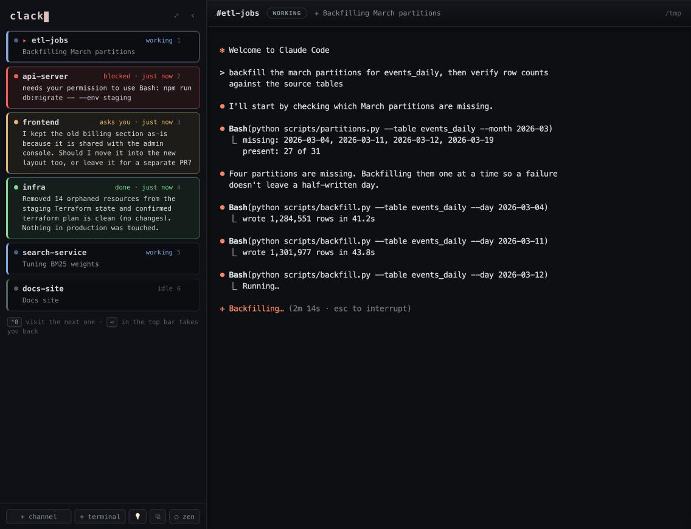
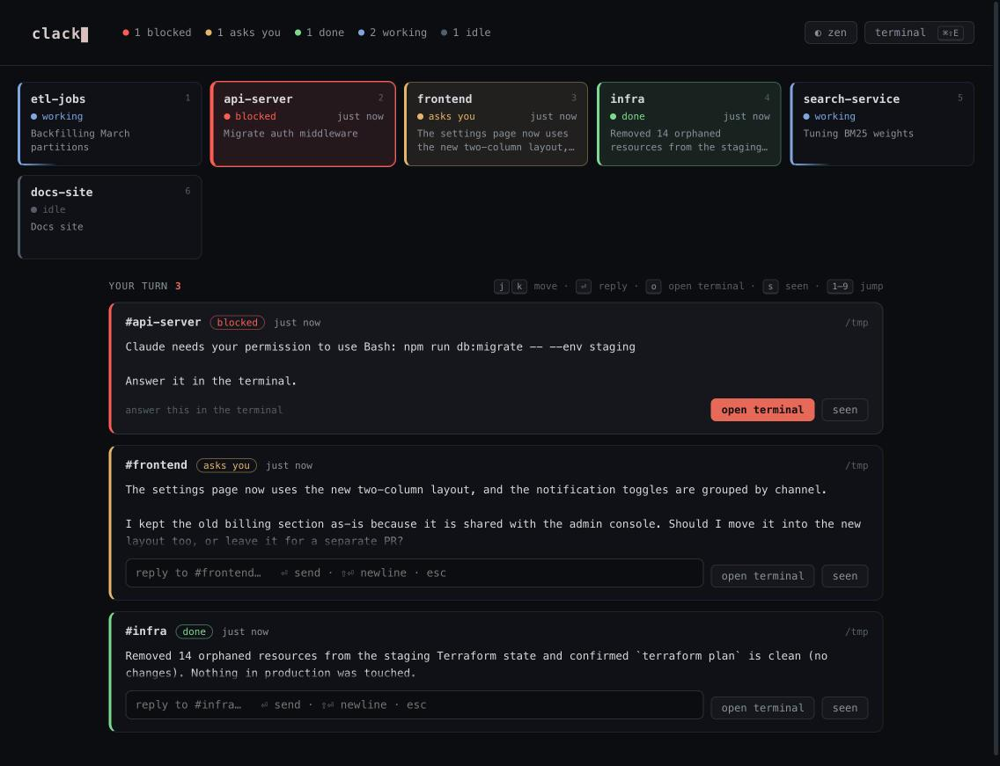

# Clack

**A Slack-esque experience for Claude Code.**



Running eight Claudes in parallel is amazing, until you notice you've become a
hamster on a wheel: flipping between terminal tabs, checking who's done, who's
stuck, who's asking you something, and who's still just working. Clack gives each
session a channel, like Slack, all in one window, and tells you at a glance
**who needs you and why**, so you stop polling and only show up when there's
something to do.

- **The dock.** Every session gets a row in a fixed spot, beside the terminal
  you're working in. A session that's waiting on you shows the actual question
  it ended on, or the permission it wants, before you go there.
- **The wall (`⌘⇧E`).** A full-screen view of every session as a colored tile,
  plus a *your turn* queue of cards with Claude's closing words. You can reply
  right on a card.

  

- **Visit and return.** `⌃0` takes you to the next session waiting on you, in
  its real terminal with all its scrollback. `↩` in the top bar takes you back
  to where you were. **Clack never switches sessions on its own.**
- **Notifications that work in auto mode.** When a turn finishes, Clack reads
  Claude's final message from the transcript and puts it in the macOS banner,
  so you hear about finished work even when Claude never asks for permission.
- **Durable sessions.** Every session lives in tmux. Restart Clack, update it,
  or crash it: nothing is lost.

Clack runs on your Mac and binds to `127.0.0.1`. There's no account, no cloud
service, and no telemetry.

## What the colors mean

| State | Color | Meaning |
|---|---|---|
| **working** | blue (pulsing) | Claude is mid-turn. Leave it alone. |
| **asks you** | amber | The turn ended on a question for you. |
| **done** | green | The turn finished. Look when you like. |
| **blocked** | red, reddening as it waits | Claude can't continue: a permission prompt. |
| **crashed** | red | The session exited unexpectedly. One click restarts it with `claude --continue`. |
| **idle** | gray | Nothing new. Finished turns go here once you've seen them. |

Only real blocks are red. Claude Code's "waiting for your input" reminder
(sent about a minute after any turn ends) never counts as a block.

## Quick start

**Requirements:** macOS, Node 22+, Xcode Command Line Tools, Homebrew (for
tmux), Google Chrome, and the [Claude Code](https://docs.claude.com/en/docs/claude-code) CLI.
`npm run setup` checks all of these first and prints the exact fix for anything
missing.

```bash
git clone https://github.com/jzic/clack.git
cd clack
npm run setup           # preflight, install, build the UI, make ~/Applications/Clack.app
npm run hooks:install   # add Clack's hooks to ~/.claude/settings.json (keeps your existing hooks)
npm start               # http://127.0.0.1:8127
```

Open **http://127.0.0.1:8127** in Chrome and click **+ channel** to start a
Claude Code session in a project folder (or **+ terminal** for a plain shell).

**Then, recommended:**

1. **Install it as an app.** In Chrome's address bar, click the install icon
   (or **⋮ → Cast, save, and share → Install page as app…**). Clack gets its own
   window, dock icon, and a red badge counting sessions that need you.
2. **Keep the server running across logins:** `npm run launchd:install`.

The hooks are what make the states accurate. Without them, Clack falls back to
watching terminal bells and output, which is much less precise. See
[`docs/claude-hooks.md`](docs/claude-hooks.md) for what gets installed.

### Updating

```bash
npm run update    # git pull, install, rebuild, restart the server
```

Sessions survive the restart (they're in tmux). Reload the Clack window after.

## Keyboard

| Key | Action |
|---|---|
| `⌃0` / `⌘0` | Visit the next session waiting on you. When none are left, go back home. |
| `⌘⇧E` | Toggle the wall |
| `⌘K` | Quick switcher (fuzzy over name, folder, and title) |
| `⌃1`–`⌃9` / `⌘1`–`⌘9` | Switch to session N |
| `⌥↑` / `⌥↓` | Previous / next session |
| `⌘⇧F` | Search every session's scrollback |
| `⌘I` | Save a spark: the highlighted text, or a note if nothing's selected |
| `⌘⇧I` | Open the sparks inbox |
| `⌘⇧Z` | Zen mode: mute banners and collapse the sidebar |

On the wall: `j`/`k` move between cards, `⏎` replies, `o` opens the terminal,
`s` marks a card seen, `1`–`9` jump to a tile.

In a browser tab, Chrome keeps `⌘1`–`⌘9` for itself; use `⌃1`–`⌃9`, or install
Clack as an app and both work.

In the dock: click a row to go there, double-click to rename, drag to reorder,
and hover for `×` to close.

## More features

- **Sparks.** Long sessions throw off ideas that die by forgetting. Highlight
  something and press `⌘I` to save it with its session and context. `⌘⇧I` opens
  the inbox, where you can promote a spark straight into a session's prompt.
- **Templates (`⧉`).** Save your current set of sessions and relaunch all of
  them in one click.
- **Search (`⌘⇧F`).** "Where did I see that stack trace?" Searches every
  session's scrollback and jumps to the hit.
- **Scratch terminals.** Plain shells for one-off commands. No Claude, no
  badges.
- **Full terminal fidelity.** Colors, vim, `Ctrl+C`, paste, and 5,000 lines of
  scrollback. Switching sessions never reflows Claude's TUI.

## How it works

- **`server/` (Node, node-pty, ws).** Owns every session: one PTY per channel,
  attached to its own tmux session, plus a state machine per channel. It runs as
  a launchd agent, so closing the UI never kills anything.
- **`web/` (Vite, React, xterm.js).** A thin view. One xterm per channel, kept
  mounted so scrollback survives, over a single multiplexed WebSocket.
- **Claude Code hooks.** Each channel's shell gets a `CLACK_CHANNEL_ID`
  environment variable. The hooks (`SessionStart`, `UserPromptSubmit`,
  `Notification`, `Stop`, `SessionEnd`) POST to the local server, which maps
  them to the right channel. On `Stop`, the server reads the turn's final
  message from the transcript to build the card and the notification.

Your channels, templates, and sparks live in `~/.clack/config.json`, on your
machine only.

### A note on macOS folder prompts

Under launchd, macOS treats the server (`node`) as its own app for privacy
purposes. The first time a session touches `~/Desktop`, `~/Documents`, or
`~/Downloads`, you'll see a **"node" wants to access…** prompt. That's your own
shell asking. Allow the folders you use rather than granting Full Disk Access.

## Development

```bash
npm run dev:server   # tsx watch on :8127 (owns the PTYs)
npm run dev:web      # Vite on :5173, proxying to :8127
npm test             # server unit tests
```

Run them separately so rebuilding the UI never touches your sessions. To try
changes without disturbing your real sessions, run a second instance against a
throwaway config:

```bash
CLACK_CONFIG=/tmp/clack-test.json CLACK_PORT=8228 npx tsx server/src/index.ts
```

## Limitations

- **macOS only**, for now: notifications, launchd, and the app install are
  macOS-specific.
- **Chrome** is the tested browser.
- A browser can't register a global hotkey or read a dropped file's path. A
  native wrapper (e.g. Tauri) could add both; the PWA install was chosen to
  avoid code signing and keep `git pull` updates.

## Feedback

Clack is young, and feedback is what shapes it. If something's broken, confusing,
or missing, [open an issue](https://github.com/jzic/clack/issues/new/choose):
there's a short form for bugs and one for ideas. Pull requests are welcome too.

## License

[MIT](LICENSE)
